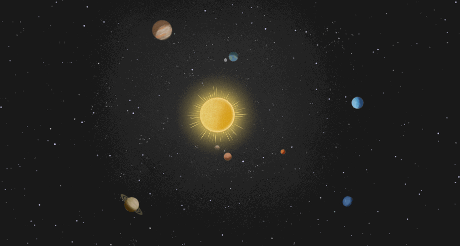

# Solar System Simulation (C# & RayLib)
A 2D N-body physics simulation of the Solar System. 



### What is it?
This project simulates the gravitational interaction of planets using Newton's law of universal gravitation. Data (mass, radius, orbit, textures) is stored in a PostgreSQL database. It was built to practice physics simulation, clean architecture, and game development loops with RayLib.

### Tech Stack
*   **Language:** C#
*   **Graphics:** RayLib-cs
*   **Database:** PostgreSQL + Dapper
*   **Architecture:** Clean Architecture + Dependency Injection

### How to run

**1. Start the Database**
Start PostgreSQL locally or using Docker:
```bash
docker docker run -d \
  --name postgres \
  -p 5432:5432 \
  -e POSTGRES_PASSWORD=mysecretpassword \
  postgres
```

**2. Configure Connection**
Add your password to src/SolarSystem.App/appsettings.json:
```json
{
  "ConnectionStrings": {
    "Postgres": "Host=localhost;Port=5432;Database=solar_system;Username=postgres;Password=your_password"
  }
}
```

**3. Configure Database**
Add table with all planets in your database using [planet.sql](https://github.com/ASDlikeS/SolarSystem/blob/master/Planets.sql) script.


**4. Run the App**
Add your password to src/SolarSystem.App/appsettings.json:
```bash
dotnet run --project src/SolarSystem.App
```

### Controls
- **Mouse Wheel**: Zoom in/out
- **Left Mouse Button**: Pan camera (drag)
- **Space**: Pause / Resume
- **Slider (Top Left)**: Change simulation speed (hours per frame)
